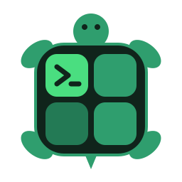

<p align="center">
  
</p>

<h1 align="center">ruckus</h1>

<p align="center">
  ROS 2 on macOS and Linux in one command, and your whole setup in one more.
</p>

<p align="center">
  <a href="https://github.com/SeamusMullan/ruckus/actions/workflows/ci.yml"></a>
  <a href="LICENSE"></a>
</p>

```console
$ ruckus install jazzy
ros-jazzy-desktop 0.11.0 with Python 3.12.15: 702 packages, 871 MB to download
installed ROS 2 jazzy in ~/.local/share/ruckus/distros/jazzy
created environment `jazzy`

$ ruckus up turtle -e jazzy
```

```
┌──────────────────────────┬──────────────────────────┐
│ turtlesim_node           │ turtle_teleop_key  ◀ keys│
├──────────────────────────┼──────────────────────────┤
│ topic echo /cmd_vel      │ topic list -v            │
└──────────────────────────┴──────────────────────────┘
```

- **Install ROS 2 in under a minute.** Humble, Jazzy, Kilted, Lyrical or
  Rolling, ready-built for macOS (Apple Silicon and Intel) and Linux. No
  source build, no Docker, no conda or pixi to set up first.
- **Keep installs and workspaces apart.** Name a ROS install plus the
  workspaces you overlay on it, then get a shell, run a command or start a
  layout with it. ROS your `.zshrc` already loads is swapped out, never mixed in.
- **Start a whole session at once.** A layout opens tmux, splits it into
  panes, loads ROS in each and starts your nodes, teleop, echoes and RViz.
  Every pane stays a normal shell.

## Install

```sh
curl -fsSL https://raw.githubusercontent.com/SeamusMullan/ruckus/main/install.sh | sh
```

The script downloads the release binary for your system to `~/.local/bin` and
checks its SHA256. If tmux is missing, it offers to install it with brew or
apt. Or, with Homebrew or Rust:

```sh
brew install SeamusMullan/ruckus/ruckus
cargo install --git https://github.com/SeamusMullan/ruckus
```

With cargo, install tmux yourself for layouts: `brew install tmux` or
`sudo apt install tmux`.

## Quick start

```sh
ruckus install jazzy           # desktop: RViz, turtlesim, demos, colcon and compilers
ruckus shell jazzy             # your usual shell, with Jazzy loaded
ruckus up turtle -e jazzy      # turtlesim, teleop and two echoes in tmux
```

## Install ROS 2

```sh
ruckus install lyrical                        # also ros2_lyrical
ruckus install kilted --variant base          # no GUI tools
ruckus install jazzy --add ros-jazzy-xacro    # add packages; they stay on later runs
ruckus install jazzy --remove ros-jazzy-xacro
ruckus install jazzy --update                 # move everything to the newest versions
ruckus install jazzy --dry-run                # what it would install, and the download size
ruckus distros                                # what is installed
ruckus uninstall jazzy
```

Packages come from [RoboStack](https://robostack.github.io), which builds ROS
for conda. ruckus resolves and installs them itself through
[rattler](https://github.com/conda/rattler), the library behind pixi. Each
distro is self-contained in `~/.local/share/ruckus/distros/<distro>`, with its
own Python and its own colcon settings, and gets an environment of the same
name.

Running `install` again keeps the packages you added and the versions you
have, unless you pass `--update`. Each install also writes a `ruckus.lock`
(in pixi's lock format) with the exact packages. Copy it to another machine
of the same platform, such as a classmate's laptop or CI, to get the identical
install:

```sh
ruckus install jazzy --lock ruckus.lock
```

### Workspace dependencies

```sh
ruckus deps -e jazzy                  # the workspace in the current directory
ruckus deps ~/nav_ws --distro jazzy
ruckus deps -e jazzy --dry-run        # what is installed and what is missing
```

`deps` does what `rosdep install` does, for a distro from `ruckus install`. It
reads every `package.xml` in the workspace, leaves out the packages the
workspace builds itself, and installs the rest, using RoboStack's mapping for
system dependencies such as `python3-numpy`.

## Environments

An environment is a ROS install plus the workspaces you overlay on it.

```sh
ruckus env create lab --ros jazzy --ws ~/lab_ws --var ROS_DOMAIN_ID=7
ruckus env create src --ros ~/ros2_lyrical/install   # a ROS you built yourself works too
ruckus env ls
ruckus env show lab               # checks the install and workspaces exist and are built
ruckus shell lab
ruckus run -e lab -- ros2 topic list
ruckus env rm lab                 # forgets it; never touches the install
```

`ruckus shell` runs your own `.zshrc` or `.bashrc` first, so your prompt and
aliases stay. If they load a ROS, ruckus unloads it before loading the
environment's. Set a default environment with `env = "lab"` under `[defaults]`
in `~/.config/ruckus/config.toml` to leave out `-e`.

## Layouts

```sh
ruckus ls                    # turtle, pubsub, urdf, and yours
ruckus show urdf             # what a layout runs
ruckus up turtle -e jazzy    # start it, or attach if it is running
ruckus up pubsub -w ~/ws     # use a different workspace
ruckus up turtle --dry-run   # print the tmux commands instead
ruckus down turtle
```

In the session: click a pane (or Ctrl+B, arrow) to move, Ctrl+B z to zoom a
pane, Ctrl+B d to leave it running.

Define your own in `~/.config/ruckus/config.toml`:

```toml
[layouts.nav]
description = "Nav2 with RViz"
workspace = "~/nav_ws"
requires = ["my_robot_bringup"]     # checked before anything starts
panes = [
  { run = "ros2 launch my_robot_bringup robot.launch.py" },
  { run = "ros2 launch nav2_bringup navigation_launch.py", delay = 5 },
  { run = "rviz2", delay = 5 },
  { focus = true },                 # an empty pane is a ready shell
]
```

See [docs/configuration.md](docs/configuration.md) for every setting.

## Shell completions

```sh
source <(ruckus completions zsh)      # in ~/.zshrc, after compinit
eval "$(ruckus completions bash)"     # in ~/.bashrc
ruckus completions fish > ~/.config/fish/completions/ruckus.fish
```

Layout, environment and distro names complete too.

## How it works

- **ROS is loaded inside the shell.** ruckus sources setup files in the shell
  it starts, instead of passing variables in. On macOS this is required:
  System Integrity Protection strips the `DYLD_*` variables ROS needs from
  anything passed to `/bin/zsh` or `/bin/bash`.
- **Installs are conda prefixes.** rattler resolves RoboStack's and
  conda-forge's packages and links them into the prefix from a shared cache,
  so a second distro or a reinstall downloads only what is new.
- **Sessions are plain tmux.** ruckus runs `tmux` commands and gets out of the
  way; `--dry-run` shows exactly which.

## Develop

```sh
cargo fmt && cargo clippy --all-targets -- -D warnings && cargo test
RUCKUS_NETWORK_TESTS=1 cargo test     # also resolve real RoboStack packages
```

Tests never touch your own tmux sessions or config: tmux tests use a private
server, and the rest a temporary home. CI also installs Jazzy and Lyrical for
real on Linux and macOS, sends a message between two nodes and builds a
package with colcon, weekly as well as on every push.

Pushing a `v*` tag builds the release archives and the Homebrew formula and
publishes them as a GitHub release. Planned work is in the
[issues](https://github.com/SeamusMullan/ruckus/issues).

## License

Apache License 2.0. See [LICENSE](LICENSE). Includes RoboStack's rosdep
mapping, under the MIT license (see [src/robostack/LICENSE](src/robostack/LICENSE)).
